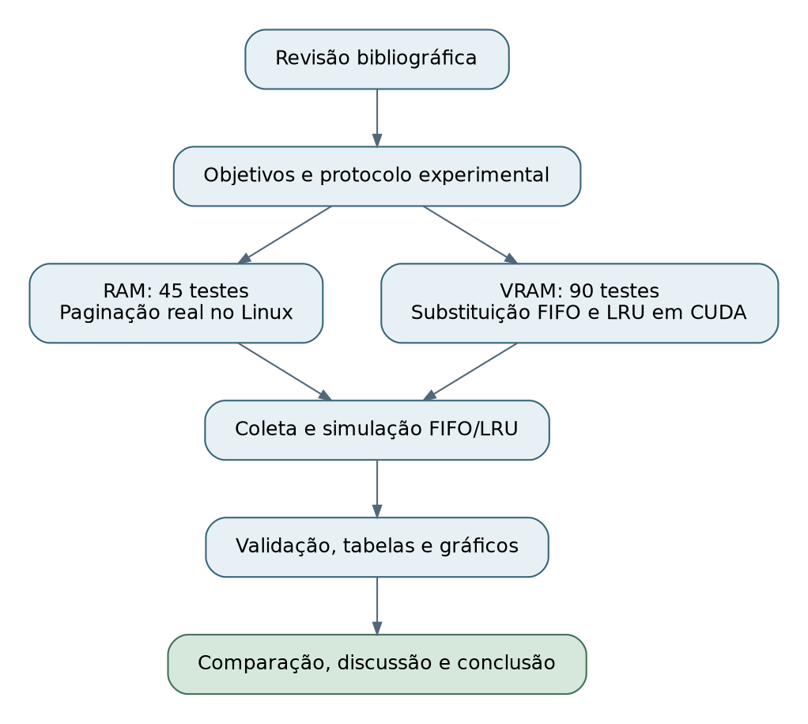
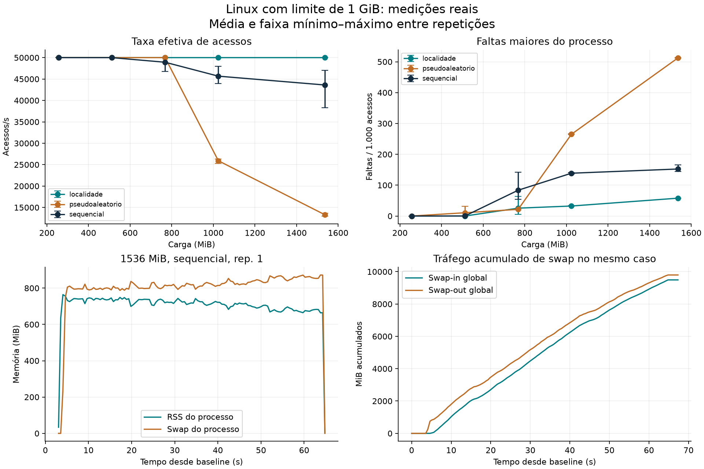
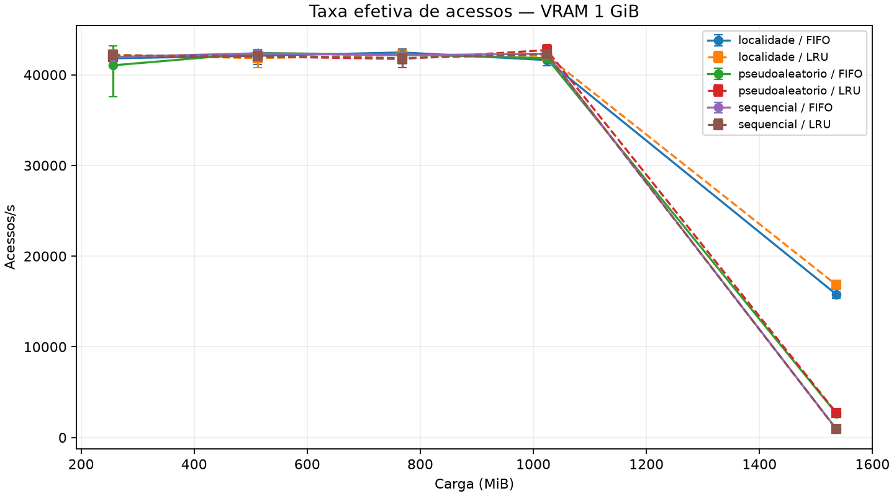
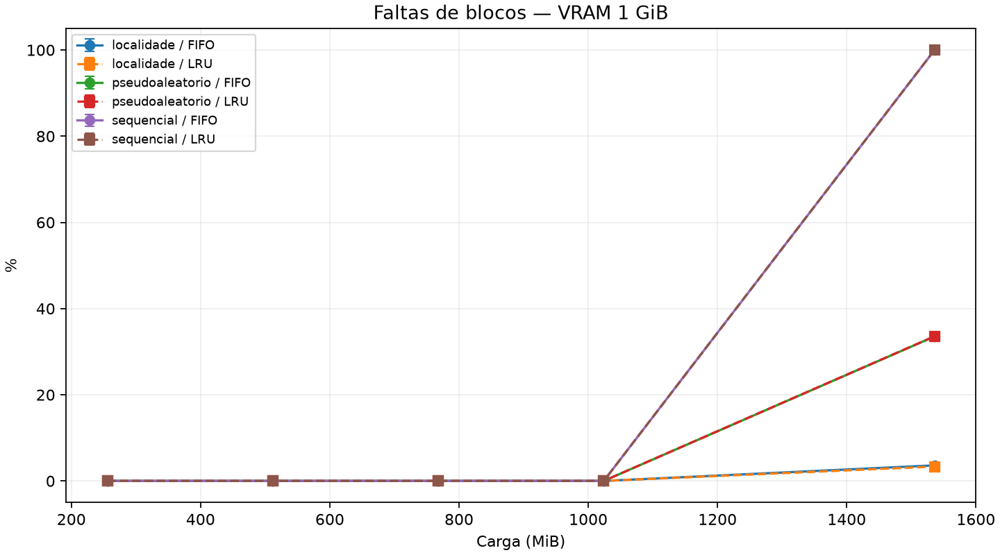

# INF0336 - Seminário

## Gerenciamento de memória: RAM, VRAM e algoritmos de substituição

## Equipe:

- 202401768 - Davi Torres de Mesquita da Silveira e Silva
- 202406915 - Diogo de Souza Alves
- 202401823 - Rafael Augusto Dias Batista
- 202406924 - Pedro Henrique Rezende de Melo

## Apresentações

1. [Primeira semana — Gerenciamento de memória e virtualização (PDF)](apresentacoes/Slides_Primeira_Semana.pdf)
2. [Segunda semana — Fundamentação e metodologia (PDF)](apresentacoes/Slides_Segunda_Semana.pdf)
3. [Terceira semana — Paginação real com 1 GiB de RAM: resultados e comparação entre FIFO e LRU](apresentacoes/Slides_Terceira_Semana.pdf)

## Resumo

A RAM e a VRAM têm capacidade limitada, o que pode exigir a movimentação de dados quando uma carga não cabe na memória disponível. O trabalho investiga como o tamanho da carga, o padrão de acesso e a política de substituição influenciam o desempenho. Foram realizados 45 testes de RAM no Ubuntu/WSL 2 e 90 testes de VRAM com CUDA. Os experimentos utilizaram cinco cargas, três padrões de acesso e três repetições, além de simulações de FIFO e LRU. Esperava-se que a localidade reduzisse as faltas e que LRU tivesse vantagem sobre FIFO nesse padrão. Os resultados confirmaram o benefício da localidade nas cargas maiores, enquanto FIFO e LRU apresentaram resultados próximos no padrão pseudoaleatório. A comparação mostra que o desempenho depende tanto da capacidade e dos padrões de acesso quanto do custo das transferências.

## Introdução

### Motivação

A memória é um recurso limitado que precisa ser compartilhado entre programas e processos. O sistema operacional utiliza memória virtual e paginação para organizar os endereços e administrar a RAM. Quando uma página necessária não está presente, pode ser preciso recuperá-la de outra área de armazenamento, o que aumenta o custo do acesso. A GPU também possui memória limitada; quando a carga ultrapassa a capacidade disponível, a transferência de dados entre RAM e VRAM pode afetar o desempenho. Por isso, o trabalho compara os efeitos da carga e da localidade nesses dois ambientes.

### Revisão bibliográfica

Arpaci-Dusseau e Arpaci-Dusseau (2018) explicam memória virtual, paginação e políticas de substituição. Maziero (2019) apresenta a tradução de endereços, a proteção da memória e as faltas de página. Denning (1968) descreve o conjunto de trabalho, formado pelas páginas usadas recentemente por um programa, ajudando a entender a localidade dos acessos. Belady (1966) estuda algoritmos de substituição de páginas, base para a comparação de FIFO e LRU. Ausavarungnirun et al. (2017), no trabalho Mosaic, discutem como o tamanho das páginas e o custo de transferência afetam o gerenciamento de memória em GPUs. Essas cinco fontes fundamentam a análise dos experimentos.

### Objetivos

O objetivo é investigar como a carga e os padrões de acesso afetam a paginação real da RAM e a substituição de blocos na VRAM. Busca-se também comparar FIFO e LRU, verificar os resultados com simulações e relacionar o comportamento observado aos conceitos de memória virtual e localidade.

## Metodologia

### Conjunto de dados (Dataset)

Os dados foram produzidos pela equipe em dois experimentos controlados. Foram utilizadas as cargas de 256, 512, 768, 1024 e 1536 MiB, com os padrões sequencial, localidade e pseudoaleatório. Cada combinação teve três repetições, com 60 segundos de acessos, coleta a cada 0,5 s e baseline de 3 s antes e depois. O teto foi de 50.000 acessos/s e a semente do gerador foi 336. A etapa de RAM totalizou 45 testes; a de VRAM, 90 testes, pois FIFO e LRU foram executados separadamente. As [instruções de reprodução](REPRODUCAO.md) estão disponíveis no repositório. Os dados brutos estão disponíveis nas pastas de [RAM](ram/resultados_linux/coleta_completa_20261118/) e [VRAM](vram/resultados_vram/coleta_completa/).

### Modelos

FIFO retira o item que entrou primeiro na memória. LRU retira o item que está há mais tempo sem ser utilizado. No experimento de RAM, esses algoritmos foram simulados em Python, enquanto o Linux controlou a paginação real. Na VRAM, ambos foram implementados na aplicação CUDA e também simulados para conferência.

#### Experimento de RAM

A bateria de RAM concluiu 45 casos: 256, 512, 768, 1024 e 1536 MiB, padrões sequencial, localidade e pseudoaleatório, três repetições e 60 segundos por fase de acessos. Teto oferecido: 50.000 acessos/s. Coleta a cada 0,5 s, baseline de 3 s antes e depois. A VM limitada a 1 GiB reportou 897,61 MiB de MemTotal, com 2 GiB de swap. A configuração original do WSL foi restaurada após a execução.

O programa C usa mmap privado anônimo, preenche todos os bytes com dados pseudoaleatórios e solicita MADV_NOHUGEPAGE. Cada referência lê e altera um byte de uma página de 4 KiB. Localidade concentra cerca de 90% das escolhas nos primeiros 5% das páginas. A semente é 336. Processo novo por caso e ordem rotacionada entre repetições. A duração real pode superar ligeiramente 60 s ao concluir lotes.

O coletor Python registra RSS e swap do processo, contadores globais de swap e PSI. getrusage mede faltas da fase de acessos excluindo inicialização. Deltas globais de swap e PSI incluem baseline/inicialização e outros processos. Análise offline reproduz o prefixo efetivamente executado e confere seu hash; não há rastreamento de todas as instruções de memória.

A execução inicial terminou antes do fim da bateria, com 41 casos completos. O caso parcial foi preservado em .interrompidos e repetido integralmente, junto aos três casos restantes, após reiniciar o ambiente. Os 45 casos analisados estão completos. ambiente.json registra a retomada e sua configuração. Essa mudança de estado do sistema é uma limitação adicional na interpretação da terceira repetição.

#### Experimento de VRAM

A bateria de VRAM concluiu 90 casos: as mesmas cinco cargas (256, 512, 768, 1024 e 1536 MiB), os mesmos três padrões de acesso, três repetições e 60 segundos por fase de acessos, para cada algoritmo (FIFO e LRU). Foram mantidos o teto de 50.000 acessos/s, a coleta a cada 0,5 s, o baseline de 3 s antes e depois e a semente 336. O ambiente foi o Ubuntu/WSL 2, com CUDA 13.5, GPU NVIDIA GeForce RTX 5060 (8151 MiB de VRAM reportados) e cerca de 7,5 GiB de RAM no WSL.

O programa CUDA reserva 1 GiB de VRAM para dados, dividido em 256 blocos de 4 MiB, e mantém uma área de apoio na RAM. Cada referência lê e altera um byte de um bloco na GPU. A localidade concentra cerca de 90% das escolhas nos primeiros 5% dos blocos. Assim como na RAM, há um processo novo por caso e a ordem dos testes é alternada entre repetições.

A área de blocos residentes começa vazia. Quando um bloco solicitado não está na VRAM, ocorre uma falta e o bloco é copiado da RAM. Se a área estiver cheia, FIFO ou LRU escolhe o bloco a ser retirado, que é copiado de volta para a RAM. Ao contrário do experimento de RAM, os dois algoritmos são executados de fato. O coletor registra os acessos, faltas, substituições, ocupação lógica e tempos das cópias. A análise offline reproduz os acessos e confere os hashes e contadores. Ao final, os blocos residentes são copiados de volta e os bytes alterados são verificados.

### Métricas

As métricas selecionadas são a taxa efetiva de acessos por segundo, as faltas por mil acessos, as taxas de faltas de FIFO e LRU e os indicadores de pressão de memória. Na RAM, foram observados também o pico de VmSwap e o PSI. Na VRAM, foram observados os dados não residentes, as substituições e os tempos de transferência RAM → VRAM e VRAM → RAM. As médias e os valores mínimo e máximo das três repetições descrevem o desempenho e a dispersão dos resultados; não representam intervalos de confiança.

### Fluxograma

## Resultados

### RAM — Resultados reais

Validação: 45 casos, 5960 amostras, 121940224 acessos e 270 simulações. Hashes conferidos. 30 casos registraram aumento dos contadores globais de entrada e saída de swap.

Médias de três repetições. Faixa mínimo–máximo descreve a dispersão observada, não intervalo de confiança.

| Carga MiB | Padrão | Acessos/s médio | Mínimo | Máximo | Faltas maiores/1000 | Pico VmSwap médio MiB |
|---:|---|---:|---:|---:|---:|---:|
| 256 | Sequencial | 49.999,86 | 49.999,74 | 49.999,97 | 0,00 | 0,00 |
| 256 | Localidade | 49.999,89 | 49.999,86 | 49.999,97 | 0,00 | 0,00 |
| 256 | Pseudoaleatório | 49.999,86 | 49.999,79 | 49.999,90 | 0,00 | 0,00 |
| 512 | Sequencial | 49.999,94 | 49.999,90 | 49.999,97 | 0,18 | 14,69 |
| 512 | Localidade | 49.999,90 | 49.999,84 | 49.999,94 | 0,00 | 0,00 |
| 512 | Pseudoaleatório | 49.999,92 | 49.999,88 | 49.999,94 | 10,62 | 35,18 |
| 768 | Sequencial | 48.926,29 | 46.782,70 | 49.999,98 | 83,63 | 170,92 |
| 768 | Localidade | 49.999,88 | 49.999,77 | 49.999,94 | 25,50 | 214,04 |
| 768 | Pseudoaleatório | 49.999,89 | 49.999,86 | 49.999,94 | 21,63 | 55,45 |
| 1024 | Sequencial | 45.674,56 | 43.942,96 | 47.929,64 | 138,75 | 304,72 |
| 1024 | Localidade | 49.999,91 | 49.999,79 | 49.999,98 | 32,41 | 319,55 |
| 1024 | Pseudoaleatório | 25.914,57 | 25.329,21 | 26.283,42 | 265,00 | 294,63 |
| 1536 | Sequencial | 43.610,65 | 38.296,36 | 47.047,75 | 152,38 | 847,72 |
| 1536 | Localidade | 49.999,95 | 49.999,92 | 49.999,98 | 57,86 | 816,23 |
| 1536 | Pseudoaleatório | 13.298,44 | 13.002,16 | 13.676,63 | 512,49 | 813,14 |

### RAM — FIFO e LRU

Capacidades lógicas: 128, 256 e 512 MiB (32768, 65536 e 131072 quadros). Simuladores começam vazios; a carga Linux já inicializou páginas. Não houve alteração da política do kernel. Resultados abaixo: taxas médias de faltas simuladas para carga de 1536 MiB.

| Padrão | Capacidade MiB | FIFO % | LRU % |
|---|---:|---:|---:|
| Sequencial | 128 | 100,00 | 100,00 |
| Sequencial | 256 | 100,00 | 100,00 |
| Sequencial | 512 | 100,00 | 100,00 |
| Localidade | 128 | 19,73 | 9,99 |
| Localidade | 256 | 12,09 | 9,11 |
| Localidade | 512 | 8,61 | 7,96 |
| Pseudoaleatório | 128 | 91,84 | 91,85 |
| Pseudoaleatório | 256 | 84,05 | 84,07 |
| Pseudoaleatório | 512 | 69,69 | 69,72 |

### RAM — Pressão de memória

PSI abaixo representa segundos acumulados de pressão global (some/full), do snapshot anterior ao caso até a saída da carga. Inclui inicialização; não é porcentagem dos 60 segundos de acessos.

| Carga MiB | Padrão | PSI some médio s | PSI full médio s |
|---:|---|---:|---:|
| 256 | Sequencial | 0,00 | 0,00 |
| 256 | Localidade | 0,00 | 0,00 |
| 256 | Pseudoaleatório | 0,00 | 0,00 |
| 512 | Sequencial | 0,05 | 0,04 |
| 512 | Localidade | 0,02 | 0,02 |
| 512 | Pseudoaleatório | 1,64 | 1,56 |
| 768 | Sequencial | 11,13 | 10,91 |
| 768 | Localidade | 1,47 | 1,41 |
| 768 | Pseudoaleatório | 6,06 | 6,04 |
| 1024 | Sequencial | 5,31 | 5,27 |
| 1024 | Localidade | 1,16 | 1,13 |
| 1024 | Pseudoaleatório | 7,39 | 7,34 |
| 1536 | Sequencial | 5,72 | 5,66 |
| 1536 | Localidade | 1,52 | 1,46 |
| 1536 | Pseudoaleatório | 3,25 | 3,20 |

### VRAM — Resultados reais

Validação: 90 casos, 12060 registros de coleta (incluindo baselines), 188884795 acessos e 180 simulações. Hashes, contadores e dados conferidos pela validação registrada. Os 90 casos estão completos. Em 18 casos houve substituições de blocos, todos na carga de 1536 MiB.

Médias de três repetições por algoritmo. A faixa mínimo–máximo descreve a dispersão observada, não intervalo de confiança. Faltas de blocos incluem o carregamento inicial. A última coluna indica o volume lógico da carga que não está residente na VRAM ao final dos acessos; é uma medida diferente do VmSwap da RAM.

| Carga MiB | Padrão | Algoritmo | Acessos/s médio | Mínimo | Máximo | Faltas de blocos/1000 | Dados não residentes MiB |
|---:|---|---|---:|---:|---:|---:|---:|
| 256 | Sequencial | FIFO | 41.971,72 | 41.550,78 | 42.566,78 | 0,03 | 0,00 |
| 256 | Sequencial | LRU | 42.135,37 | 41.751,05 | 42.342,29 | 0,03 | 0,00 |
| 256 | Localidade | FIFO | 41.819,23 | 41.804,52 | 41.840,13 | 0,03 | 0,00 |
| 256 | Localidade | LRU | 42.213,78 | 41.457,78 | 42.762,96 | 0,03 | 0,00 |
| 256 | Pseudoaleatório | FIFO | 41.041,89 | 37.599,06 | 43.207,38 | 0,03 | 0,00 |
| 256 | Pseudoaleatório | LRU | 41.981,77 | 41.626,42 | 42.219,30 | 0,03 | 0,00 |
| 512 | Sequencial | FIFO | 42.371,67 | 42.139,49 | 42.710,08 | 0,05 | 0,00 |
| 512 | Sequencial | LRU | 42.104,50 | 41.924,06 | 42.333,36 | 0,05 | 0,00 |
| 512 | Localidade | FIFO | 42.100,17 | 41.113,10 | 42.796,84 | 0,05 | 0,00 |
| 512 | Localidade | LRU | 41.825,05 | 40.816,59 | 42.361,42 | 0,05 | 0,00 |
| 512 | Pseudoaleatório | FIFO | 42.401,91 | 42.264,81 | 42.605,02 | 0,05 | 0,00 |
| 512 | Pseudoaleatório | LRU | 42.015,02 | 41.567,60 | 42.486,22 | 0,05 | 0,00 |
| 768 | Sequencial | FIFO | 42.150,16 | 41.238,79 | 42.627,59 | 0,08 | 0,00 |
| 768 | Sequencial | LRU | 41.826,84 | 40.803,83 | 42.871,96 | 0,08 | 0,00 |
| 768 | Localidade | FIFO | 42.465,44 | 42.241,45 | 42.606,86 | 0,08 | 0,00 |
| 768 | Localidade | LRU | 42.202,19 | 41.981,80 | 42.520,95 | 0,08 | 0,00 |
| 768 | Pseudoaleatório | FIFO | 42.225,97 | 41.824,21 | 42.710,55 | 0,08 | 0,00 |
| 768 | Pseudoaleatório | LRU | 41.748,32 | 41.288,05 | 42.303,36 | 0,08 | 0,00 |
| 1024 | Sequencial | FIFO | 42.321,94 | 41.551,75 | 42.977,37 | 0,10 | 0,00 |
| 1024 | Sequencial | LRU | 42.290,26 | 41.917,89 | 42.974,68 | 0,10 | 0,00 |
| 1024 | Localidade | FIFO | 41.625,66 | 40.992,71 | 42.056,19 | 0,10 | 0,00 |
| 1024 | Localidade | LRU | 42.092,59 | 41.992,99 | 42.245,84 | 0,10 | 0,00 |
| 1024 | Pseudoaleatório | FIFO | 41.834,65 | 41.438,98 | 42.190,30 | 0,10 | 0,00 |
| 1024 | Pseudoaleatório | LRU | 42.725,34 | 42.366,21 | 43.322,80 | 0,10 | 0,00 |
| 1536 | Sequencial | FIFO | 938,48 | 915,88 | 963,07 | 1.000,00 | 512,00 |
| 1536 | Sequencial | LRU | 918,12 | 845,64 | 962,50 | 1.000,00 | 512,00 |
| 1536 | Localidade | FIFO | 15.784,50 | 15.329,94 | 16.016,85 | 36,17 | 512,00 |
| 1536 | Localidade | LRU | 16.833,49 | 16.321,22 | 17.106,45 | 33,44 | 512,00 |
| 1536 | Pseudoaleatório | FIFO | 2.661,96 | 2.627,70 | 2.697,43 | 335,36 | 512,00 |
| 1536 | Pseudoaleatório | LRU | 2.731,53 | 2.699,02 | 2.783,70 | 335,71 | 512,00 |

### VRAM — FIFO e LRU

Capacidade lógica: 1024 MiB (256 blocos). As simulações começam vazias, assim como a área de blocos residentes do programa CUDA. Foram simulados os dois algoritmos para a sequência efetivamente executada em cada teste. Resultados abaixo: taxas médias de faltas simuladas para a carga de 1536 MiB, considerando as seis sequências de cada padrão (três de FIFO e três de LRU).

| Padrão | Capacidade MiB | FIFO % | LRU % |
|---|---:|---:|---:|
| Sequencial | 1024 | 100,00 | 100,00 |
| Localidade | 1024 | 3,62 | 3,34 |
| Pseudoaleatório | 1024 | 33,54 | 33,56 |

As faltas do algoritmo executado coincidiram com as da simulação correspondente em cada caso. Nos testes reais de 1536 MiB com localidade, FIFO teve 3,62% de faltas e LRU, 3,34%. No padrão pseudoaleatório, as taxas reais foram 33,54% e 33,57%, respectivamente. No sequencial, ambos tiveram 100% de faltas.

### VRAM — Pressão de memória e transferências

Na VRAM, a pressão sobre a capacidade lógica é observada pelas substituições e pelo tempo de movimentação de dados, e não pelo PSI do Linux. Até 1024 MiB, não houve substituições. O tempo médio de cópia da RAM para a VRAM ficou abaixo de 0,17 s em todos esses grupos, e não houve cópias de retorno durante a fase de acessos.

Na carga de 1536 MiB, os tempos médios acumulados de transferência durante a fase de acessos foram:

| Carga MiB | Padrão | Algoritmo | RAM → VRAM médio s | VRAM → RAM médio s |
|---:|---|---|---:|---:|
| 1536 | Sequencial | FIFO | 25,35 | 29,21 |
| 1536 | Sequencial | LRU | 25,25 | 29,30 |
| 1536 | Localidade | FIFO | 15,40 | 17,71 |
| 1536 | Localidade | LRU | 14,96 | 17,41 |
| 1536 | Pseudoaleatório | FIFO | 24,04 | 27,88 |
| 1536 | Pseudoaleatório | LRU | 24,00 | 28,09 |

## Discussão

### RAM

Na carga de 1536 MiB, a localidade manteve aproximadamente 50 mil acessos/s, o sequencial atingiu 43.611 e o pseudoaleatório, 13.298. A carga pseudoaleatória já caiu para 25.915 acessos/s em 1024 MiB. As cargas intermediárias permitem localizar essa mudança dentro da faixa testada, sem atribuir um limiar universal de paginação.

Em 128 MiB simulados, FIFO teve 19,73% de faltas com localidade e LRU, 9,99%: diferença de 9,73 pontos percentuais calculada antes do arredondamento. A vantagem não se generaliza: no pseudoaleatório, FIFO e LRU produziram valores próximos. Os resultados fecham a etapa de RAM dentro do protocolo adotado, mantendo as limitações de capacidade, estado inicial, ambiente e retomada descritas acima.

O comportamento da carga com localidade é consistente com o conceito de conjunto de trabalho de Denning (1968): concentrar os acessos em uma parte da memória reduz a necessidade de recuperar dados ausentes. A discussão de substituição de páginas de Belady (1966) e dos livros de Arpaci-Dusseau e Arpaci-Dusseau (2018) e Maziero (2019) ajuda a interpretar a vantagem de LRU nesse padrão, sem implicar que o Linux tenha utilizado FIFO ou LRU puro.

### VRAM

Até 1024 MiB, os dois algoritmos mantiveram médias próximas de 42 mil acessos/s, sem substituições. Na carga de 1536 MiB, a localidade apresentou o melhor resultado: 15.785 acessos/s com FIFO e 16.833 com LRU. O pseudoaleatório atingiu 2.662 e 2.732 acessos/s, respectivamente. O sequencial teve o pior resultado, com 938 acessos/s em FIFO e 918 em LRU.

No padrão sequencial, a carga de 384 blocos é maior que os 256 blocos disponíveis. Quando o programa volta a solicitar um bloco, ele já foi retirado da VRAM, provocando uma nova falta. Com localidade, os blocos mais utilizados permanecem por mais tempo na VRAM. LRU apresentou menos faltas e maior taxa média de acessos que FIFO nesse padrão. No pseudoaleatório, os resultados dos dois algoritmos ficaram próximos, sem indicar uma vantagem geral de um sobre o outro.

Os resultados também se relacionam à discussão de Ausavarungnirun et al. (2017) sobre o custo de movimentar dados na memória das GPUs. Neste experimento, cada falta carrega um bloco de 4 MiB, o que ajuda a explicar a queda de desempenho quando as substituições se tornam frequentes. Não se trata de uma reprodução do mecanismo Mosaic.

### Comparação entre RAM e VRAM

A localidade apresentou o melhor desempenho na carga de 1536 MiB nos dois experimentos. Na RAM, manteve aproximadamente 50 mil acessos/s, enquanto na VRAM a média caiu para cerca de 16 mil acessos/s. Em ambos os casos, as simulações indicaram vantagem de LRU sobre FIFO no padrão com localidade e resultados próximos no pseudoaleatório.

O padrão com pior desempenho foi diferente: pseudoaleatório na RAM e sequencial na VRAM. No primeiro experimento, a paginação foi controlada pelo Linux e as faltas maiores foram medidas pelo sistema. No segundo, a substituição foi controlada pelo programa e cada falta exigiu a cópia de um bloco de 4 MiB. Além disso, cada acesso na GPU exigiu lançamento e sincronização de um kernel.

Os resultados mostram que o desempenho depende da capacidade disponível, da localidade, da política de substituição e do custo de movimentação dos dados. As taxas de acessos e de faltas não permitem concluir diretamente que a RAM é mais rápida que a VRAM: as unidades de memória (4 KiB e 4 MiB), o estado inicial, as capacidades efetivas e os mecanismos de acesso são diferentes.

### Limitações

Uma VM, três repetições e estado global persistente entre casos limitam generalização. Não interpretar 50 mil acessos/s como velocidade máxima do hardware. Faltas maiores, faltas simuladas e substituições não são equivalentes. Os contadores globais incluem outros processos e não comprovam que cada transferência atingiu fisicamente o SSD do host. A coleta curta de 18 casos permanece separada no histórico de resultados; não foi combinada às médias de 60 segundos.

Os tempos não incluem a cópia final dos blocos residentes para a RAM. A VRAM foi limitada pela aplicação, não pelo driver NVIDIA. O contexto CUDA e outros programas podem consumir memória adicional. Cada referência executa um kernel CUDA e aguarda sua conclusão. Esse custo também afeta a taxa de acessos, mesmo sem substituições. Uma GPU, três repetições e o uso de WSL 2 limitam a generalização dos resultados. O teto de 50.000 acessos/s não representa a velocidade máxima do hardware.

## Conclusão

Os objetivos do trabalho foram alcançados dentro do protocolo adotado. Os experimentos mostraram que a capacidade disponível e a localidade dos acessos influenciam o desempenho da RAM e da VRAM. A comparação entre FIFO e LRU mostrou vantagem de LRU no padrão com localidade, mas resultados próximos no pseudoaleatório. A validação das sequências e dos contadores permitiu relacionar as medições às simulações. As diferenças entre páginas de 4 KiB e blocos de 4 MiB, assim como entre a paginação do Linux e a substituição controlada pela aplicação CUDA, impedem uma comparação direta da velocidade física das duas memórias.

## Referências

ARPACI-DUSSEAU, Remzi H.; ARPACI-DUSSEAU, Andrea C. **Operating systems: three easy pieces**. [S. l.]: Arpaci-Dusseau Books, 2018. Disponível em: https://pages.cs.wisc.edu/~remzi/OSTEP/. Acesso em: 4 nov. 2026.

AUSAVARUNGNIRUN, Rachata et al. Mosaic: a GPU memory manager with application-transparent support for multiple page sizes. In: IEEE/ACM INTERNATIONAL SYMPOSIUM ON MICROARCHITECTURE, 50., 2017, Cambridge. *Proceedings [...]*. [S. l.]: ACM, 2017. p. 136-150. DOI: 10.1145/3123939.3123975. Disponível em: https://doi.org/10.1145/3123939.3123975. Acesso em: 25 nov. 2026.

BELADY, L. A. A study of replacement algorithms for a virtual-storage computer. *IBM Systems Journal*, v. 5, n. 2, p. 78-101, 1966. DOI: 10.1147/sj.52.0078. Disponível em: https://doi.org/10.1147/sj.52.0078. Acesso em: 4 nov. 2026.

DENNING, Peter J. The working set model for program behavior. *Communications of the ACM*, v. 11, n. 5, p. 323-333, 1968. DOI: 10.1145/363095.363141. Disponível em: https://doi.org/10.1145/363095.363141. Acesso em: 4 nov. 2026.

LINUX MAN-PAGES. **mmap(2)**. Disponível em: https://man7.org/linux/man-pages/man2/mmap.2.html. Documentação do mapeamento de memória.

MAZIERO, Carlos Alberto. **Sistemas operacionais: conceitos e mecanismos**. Curitiba: DINF/UFPR, 2019. Disponível em: https://wiki.inf.ufpr.br/maziero/doku.php?id=so:livro_de_sistemas_operacionais. Acesso em: 4 nov. 2026.

MICROSOFT. **Advanced settings configuration in WSL**. Disponível em: https://learn.microsoft.com/en-us/windows/wsl/wsl-config. Documentação de configuração do ambiente.

THE LINUX KERNEL. **The /proc filesystem**. Disponível em: https://docs.kernel.org/filesystems/proc.html. Documentação dos indicadores de memória e processo.
